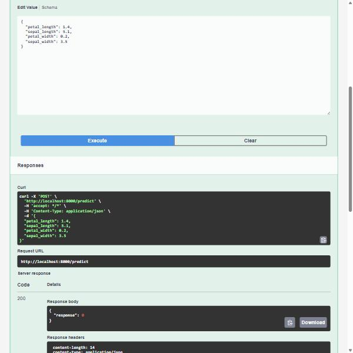

# Lab 03 – FastAPI: Serving an Iris Classifier as an API

Based on the course [FastAPI Lab](https://github.com/raminmohammadi/MLOps/tree/main/Labs/API_Labs/FastAPI_Labs).
A Decision Tree Classifier is trained on the Iris dataset and served as a REST API with [FastAPI](https://fastapi.tiangolo.com/) and [uvicorn](https://www.uvicorn.org/).

## Files

```
assets/
├── docs.png              Swagger UI page at /docs
└── api_response.jpg      /predict called from Swagger UI ("Try it out")

model/
└── iris_model.pkl        trained Decision Tree (created by train.py)

src/
├── __init__.py
├── data.py               loads Iris and makes a 70/30 train/test split
├── train.py              fits DecisionTreeClassifier(max_depth=3) and saves it with joblib
├── predict.py            loads the saved model and predicts
└── main.py               FastAPI app: GET / (health) and POST /predict

requirements.txt          scikit-learn 1.5.1, fastapi[all] 0.111.1 (includes uvicorn)
```

## How to run

Tested with Python 3.12 on Windows (PowerShell).

1. Create and activate a virtual environment, then install the requirements:

    ```powershell
    python -m venv .venv
    .venv\Scripts\activate
    pip install -r requirements.txt
    ```

2. Train the model. The scripts use paths relative to `src/` (`../model/iris_model.pkl`), so run them from there:

    ```powershell
    cd src
    python train.py
    ```

3. Start the API:

    ```powershell
    uvicorn main:app --reload
    ```

    > The course README says `uvicorn app:main`, which fails. The format is `<file>:<FastAPI instance>`, and the app instance `app` lives in `main.py`, so the command is `uvicorn main:app`.

4. Open the interactive docs at <http://127.0.0.1:8000/docs>.

## Endpoints

| Method | Path | Request body | Response |
|---|---|---|---|
| GET | `/` | none | `{"status": "healthy"}` |
| POST | `/predict` | `IrisData`: `sepal_length`, `sepal_width`, `petal_length`, `petal_width` (floats, cm) | `IrisResponse`: `{"response": <class>}` where 0 = setosa, 1 = versicolor, 2 = virginica |

## Results


Calling `/predict` from Swagger UI (POST /predict → Try it out → Execute) with a setosa sample returns `200` and class `0`:



The same checks from the command line:

```powershell
curl.exe -X POST http://127.0.0.1:8000/predict -H "Content-Type: application/json" `
  -d '{\"sepal_length\": 5.1, \"sepal_width\": 3.5, \"petal_length\": 1.4, \"petal_width\": 0.2}'
```

| Input (sepal length, sepal width, petal length, petal width) | Status | Response |
|---|---|---|
| 5.1, 3.5, 1.4, 0.2 (setosa) | 200 | `{"response": 0}` |
| 6.9, 3.1, 5.4, 2.1 (virginica) | 200 | `{"response": 2}` |
| `{"sepal_length": "five"}` | 422 | Pydantic lists the unparseable float and the three missing fields |

The 422 shows FastAPI's request validation working without any extra code. `IrisData` declares four floats, so a missing field or a non-numeric value is rejected before the model is called.
