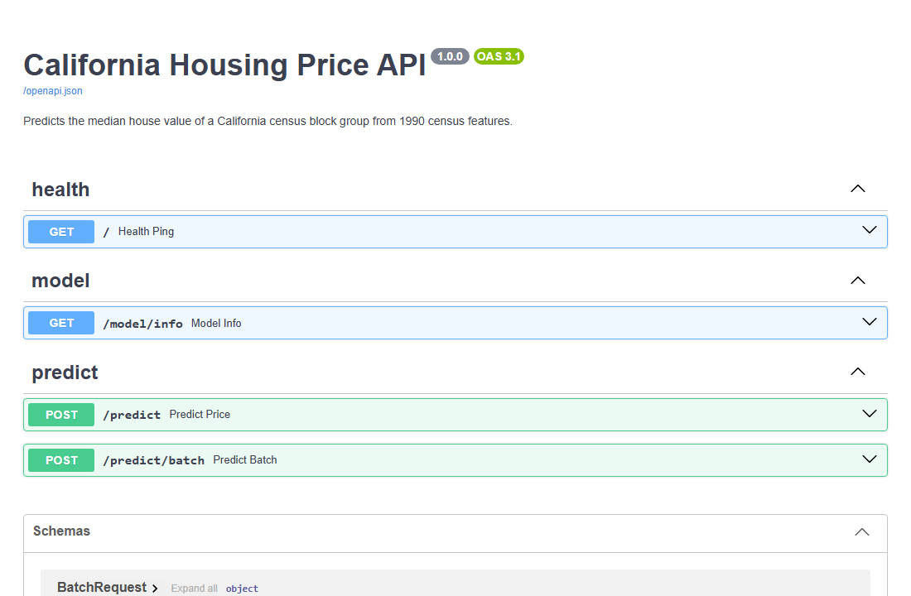
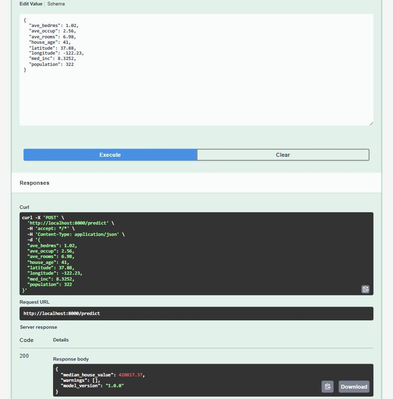
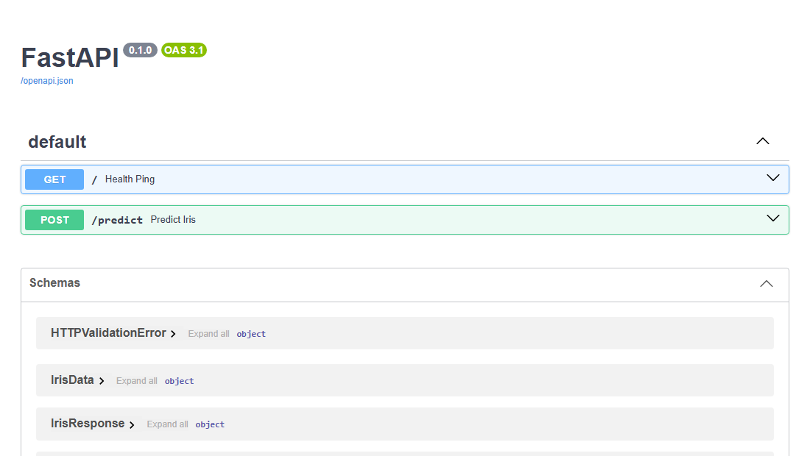

# Lab 03 – FastAPI: California Housing Price API

[](https://github.com/keithfernandes12/IE-7374-MLOps-Lab03/actions/workflows/ci.yml)

Based on the course [FastAPI Lab](https://github.com/raminmohammadi/MLOps/tree/main/Labs/API_Labs/FastAPI_Labs).
I completed the original lab (an Iris Decision Tree served with FastAPI and uvicorn, see [Original lab](#original-lab-iris)), then rebuilt it for a harder, real-world problem: predicting **California house prices** from 1990 census data. The training script compares three models and serves the best one, and the API validates inputs, warns when a request is outside what the model was trained on, and reports which model version answered.

## What I changed from the original lab

| Area | Original lab | This version |
|---|---|---|
| Dataset | Iris (150 flowers, 4 features, classification) | California Housing (20,640 block groups, 8 features, regression) |
| Model | One Decision Tree, test split created but never scored | Compares Linear Regression, Decision Tree and HistGradientBoosting with 5-fold CV, serves the best, scores it on the test set |
| Model metadata | None | `metadata.json`: version, training date, sklearn version, CV and test metrics, training feature ranges |
| Paths | `../model/iris_model.pkl`, only works from `src/` | Built from the file location in `config.py`, works from any folder; `MODEL_DIR` env var override |
| Model loading | Loaded from disk on every request | Loaded once at startup with FastAPI `lifespan` |
| Route functions | `async def` around blocking `model.predict` | Plain `def`, so FastAPI runs them in a thread pool instead of blocking the event loop |
| Input validation | Type checks only | Range limits on every field (`Field(gt=..., le=...)`), California lat/long bounds, bedrooms ≤ rooms check |
| Response | `{"response": 0}` | Price in USD, warnings and model version |
| Endpoints | `GET /`, `POST /predict` | Adds `POST /predict/batch` (up to 100 rows) and `GET /model/info` |
| Missing model | 500 error with the raw exception text | `GET /` reports `model_loaded: false`; prediction routes return 503 |
| Input monitoring | None | Warns when a feature is outside the 1st–99th percentile of training data, or the prediction hits the dataset's $500k cap |
| Tests | None | 19 pytest tests for training and the API (`TestClient`) |
| Packaging | Run with uvicorn locally | Dockerfile (non-root user) |
| CI | None | GitHub Actions retrains the model, runs the tests, builds the image and smoke-tests the container |

## Files

```
.github/workflows/
└── ci.yml                CI: retrain, pytest, docker build + smoke test

src/
├── config.py             paths, feature order, model version, target units
├── data.py               loads California Housing and makes an 80/20 train/test split
├── train.py              compares candidates with CV, fits the best, saves model + metadata
├── predict.py            loads the model, predicts, builds input warnings
└── main.py               FastAPI app: schemas, lifespan, routes

model/
├── housing_model.pkl     trained HistGradientBoostingRegressor (0.4 MB)
└── metadata.json         what GET /model/info serves

tests/
├── test_train.py         pipeline writes files, picks lowest CV RMSE, R² > 0.8
└── test_api.py           predictions, validation errors, batch, model info, 503 without a model

assets/                   Swagger UI screenshots (original lab and this version)
Dockerfile, .dockerignore
requirements.txt          runtime: scikit-learn 1.5.1, fastapi[all] 0.111.1
requirements-dev.txt      adds pytest
pytest.ini                puts src/ on the import path for tests
```

## The model

The target is the median house value of a census block group, in units of $100,000. `train.py` scores each candidate with 5-fold cross-validation on the 16,512 training rows, refits the one with the lowest RMSE and scores it once on the 4,128 held-out test rows.

| Model | CV RMSE | Notes |
|---|---|---|
| Linear Regression | 0.726 ± 0.022 | Baseline |
| Decision Tree (max_depth=8) | 0.651 ± 0.022 | The original lab's algorithm, as a regressor |
| **HistGradientBoosting** | **0.475 ± 0.013** | Selected |

On the test set the selected model gets **R² = 0.844, RMSE ≈ $46,200, MAE ≈ $31,100**.

I also tried a Random Forest (100 trees). It scored worse (CV RMSE 0.510) and saved to a **145 MB** file, too big to keep in the repo or ship in an image, so it's not a candidate. The gradient boosting model is 0.4 MB.

## API

| Method | Path | Body | Returns |
|---|---|---|---|
| GET | `/` | none | `{"status": "healthy", "model_loaded": true}` |
| GET | `/model/info` | none | Model version, name, training date, CV and test metrics, feature ranges |
| POST | `/predict` | one `HousingData` | `{"median_house_value": 420817.37, "warnings": [], "model_version": "1.0.0"}` |
| POST | `/predict/batch` | `{"samples": [HousingData, ...]}` (1–100) | `{"model_version": "1.0.0", "predictions": [...]}` in the same order |

`HousingData` fields:

| Field | Meaning | Allowed |
|---|---|---|
| `med_inc` | Median household income, in $10,000s | > 0, ≤ 20 |
| `house_age` | Median house age, years | 0–100 |
| `ave_rooms` | Average rooms per household | > 0, ≤ 200 |
| `ave_bedrms` | Average bedrooms per household | > 0, ≤ 50, and ≤ `ave_rooms` |
| `population` | Block group population | 1–100,000 |
| `ave_occup` | Average household members | > 0, ≤ 2,000 |
| `latitude` | Latitude | 32.5–42.0 (California) |
| `longitude` | Longitude | −124.5 to −114.0 (California) |

## Design choices

- **Two levels of input checking.** Impossible values (negative income, a point outside California, more bedrooms than rooms) are rejected with a 422. Values that are possible but rare in the training data are accepted, and the response carries a warning. For example `med_inc = 14.5` is valid, but only 1% of training rows are above 10.45, so the prediction is less trustworthy. Rejecting it would be wrong, and silently answering hides the risk.
- **Percentiles, not min/max, for warnings.** The raw training maximums include extreme outliers (an `ave_occup` of 1,243), so a min/max check would almost never fire. The 1st–99th percentile range marks where the model has seen enough data.
- **Price cap warning.** The dataset caps values at $500,001 (about 5% of rows sit at the cap), so the model can't learn prices above it. Predictions at the cap get a warning that the true value may be higher.
- **Model version in every response**, so a logged prediction can be traced back to the model that made it.
- **Model selection by CV, not the test set.** The test set is used once, after selection, so the reported test metrics are not optimistic.
- **Start without a model.** If the model file is missing the API still starts, `GET /` says `model_loaded: false`, and prediction routes return 503 with a hint to run `train.py`. A health check can then tell "API down" from "model missing". FastAPI's `Depends` keeps that check in one place (`get_model`).
- **Separate runtime and dev requirements**, so pytest isn't installed in the Docker image.

## How to run

**Requires Python 3.9–3.12.** The course pins `scikit-learn==1.5.1`, which has no installers for Python 3.13 or newer, so `pip install` fails there. Tested with Python 3.12 on Windows and on Ubuntu (CI). If you don't have Python 3.12, use [Docker](#option-b-docker) instead.

### Option A: Python

```bash
git clone https://github.com/keithfernandes12/IE-7374-MLOps-Lab03.git
cd IE-7374-MLOps-Lab03
python -m venv .venv
```

Activate the environment:

| OS | Command |
|---|---|
| Windows (PowerShell) | `.venv\Scripts\activate` |
| macOS / Linux | `source .venv/bin/activate` |

If PowerShell says running scripts is disabled, run `Set-ExecutionPolicy -Scope Process -ExecutionPolicy Bypass` first. It only applies to the current window.

Then, from the repo root:

```bash
pip install -r requirements-dev.txt
python src/train.py                         # downloads the data on first run (~370 KB)
pytest                                      # 19 tests
uvicorn main:app --app-dir src --reload     # http://127.0.0.1:8000/docs
```

### Option B: Docker

Needs only Docker. The image uses Python 3.12 and serves the trained model from the repo.

```bash
docker build -t housing-api .
docker run --rm -p 8000:8000 housing-api    # http://127.0.0.1:8000/docs
```

## Reproducing the results

Training is deterministic (fixed `random_state`, unshuffled CV folds). I checked this from a fresh clone on Windows, and CI retrains on Ubuntu on every push:

| Step | Expected result |
|---|---|
| `python src/train.py` | The output below. `model/housing_model.pkl` is rebuilt byte-for-byte identical; only `trained_at` in `metadata.json` changes |
| `pytest` | `19 passed` |
| `GET /` | `{"status":"healthy","model_loaded":true}` |
| `POST /predict` with the Swagger example | `"median_house_value": 420817.37` |
| `POST /predict` with `med_inc` = 14.5 | `437823.35` plus one MedInc warning (see below) |

```
linear_regression        CV RMSE 0.726 ± 0.022
decision_tree            CV RMSE 0.651 ± 0.022
hist_gradient_boosting   CV RMSE 0.475 ± 0.013
Selected hist_gradient_boosting: test {'rmse': 0.4622, 'mae': 0.3109, 'r2': 0.8442, 'rmse_usd': 46219, 'mae_usd': 31086}
```

## Verifying it works



**A prediction.** The Swagger example is the first row of the dataset, whose true median value is $452,600. The model predicts $420,817:



**A warning.** A very high income is accepted but flagged. In Swagger UI, change `med_inc` to `14.5`, or use curl:

```powershell
# Windows PowerShell
curl.exe -X POST http://127.0.0.1:8000/predict -H "Content-Type: application/json" `
  -d '{\"med_inc\": 14.5, \"house_age\": 41, \"ave_rooms\": 6.98, \"ave_bedrms\": 1.02, \"population\": 322, \"ave_occup\": 2.56, \"latitude\": 37.88, \"longitude\": -122.23}'
```

```bash
# macOS / Linux
curl -X POST http://127.0.0.1:8000/predict -H "Content-Type: application/json" \
  -d '{"med_inc": 14.5, "house_age": 41, "ave_rooms": 6.98, "ave_bedrms": 1.02, "population": 322, "ave_occup": 2.56, "latitude": 37.88, "longitude": -122.23}'
```

```json
{"median_house_value": 437823.35,
 "warnings": ["MedInc=14.5 is outside the 1st-99th percentile of training data (1.0618 to 10.4546); the prediction may be unreliable."],
 "model_version": "1.0.0"}
```

**Rejected input.** `"ave_bedrms": 9` with `"ave_rooms": 6.98` returns 422 with `ave_bedrms cannot be greater than ave_rooms`, and `"latitude": 50` returns 422 with `Input should be less than or equal to 42`.

**Tests.** `pytest` runs 19 tests in about 4 seconds, all passing.

## Original lab (Iris)

I first completed the course lab as written: a `DecisionTreeClassifier(max_depth=3)` on Iris, served at `POST /predict` and returning the class number. It is in the [first commit](https://github.com/keithfernandes12/IE-7374-MLOps-Lab03/commit/ad4b029).

One fix was needed to run it: the course README says `uvicorn app:main`, which fails. The format is `<file>:<FastAPI instance>`, and the instance `app` lives in `main.py`, so the command is `uvicorn main:app`.

| Swagger UI | `/predict` with a setosa sample → class 0 |
|---|---|
|  |  |
